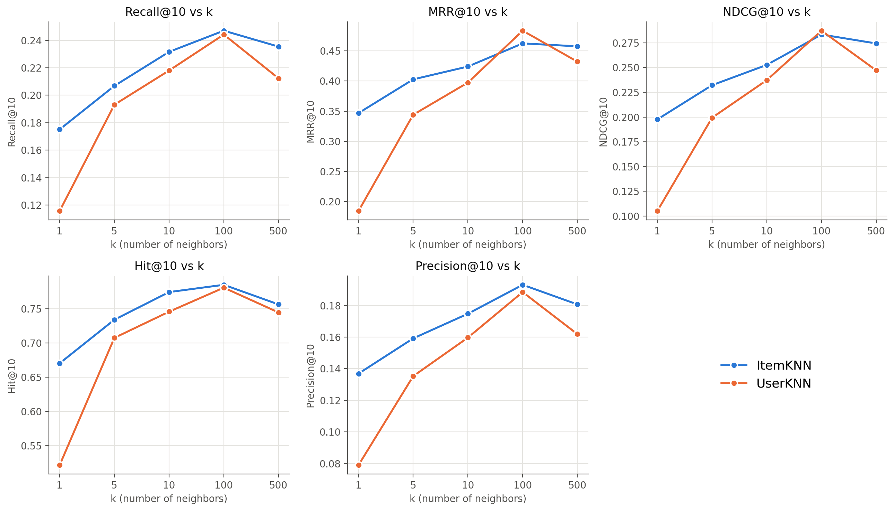
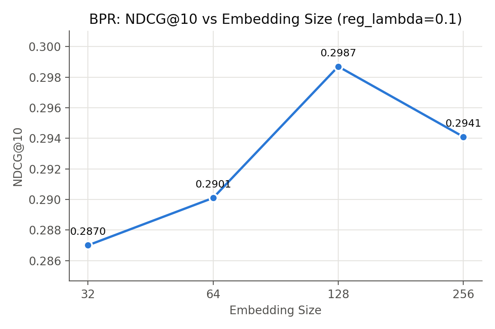
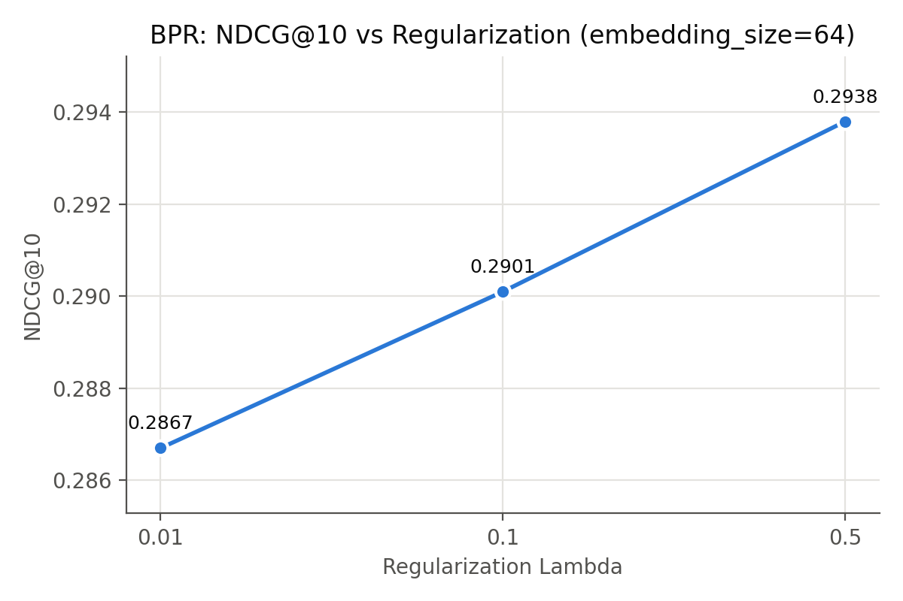
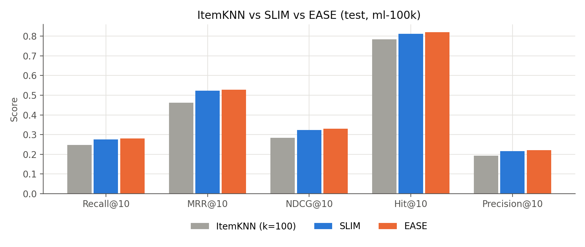

# Introduction to Recommender Systems (Fall 2026) — Homework #1

Experiments with [RecBole](https://github.com/RUCAIBox/RecBole) 1.2.1 on the `ml-100k` dataset.

| Part | Models | What is varied |
|---|---|---|
| (1) Neighborhood-based CF | ItemKNN, UserKNN (`knn_method=user`) | k ∈ {1, 5, 10, 100, 500} |
| (2) Latent factor model | BPR | embedding_size ∈ {32, 64, 128, 256} (reg_lambda=0.1), reg_lambda ∈ {0.01, 0.1, 0.5} (embedding_size=64) |
| (3) Item-to-item CF | SLIM (SLIMElastic), EASE, ItemKNN | — |

Setup: random split 8:1:1, full ranking, seed 2020, metrics @10 (Recall, MRR, NDCG, Hit, Precision), test-set scores reported.

## Files

- `run_experiments.py` — runs every configuration and stores the scores in `results.json`
- `bpr_reg.py` — BPR with an L2 term (`BPRLoss + reg_lambda * EmbLoss`); RecBole's BPR has no `reg_lambda` option
- `plot_results.py` — draws the plots in `figures/`
- `results.json` — all validation/test scores
- `*.log`, `log/` — RecBole training logs

## Reproduce

```bash
pip install recbole "torch<2.3" "numpy<2" matplotlib
python run_experiments.py          # or: python run_experiments.py knn bpr item2item
python plot_results.py
```

## Results (test NDCG@10)

| Model | NDCG@10 |
|---|---|
| ItemKNN (k=100) | 0.2834 |
| UserKNN (k=100) | 0.2873 |
| BPR (d=128, reg_lambda=0.1) | 0.2987 |
| SLIM | 0.3236 |
| EASE | **0.3295** |





